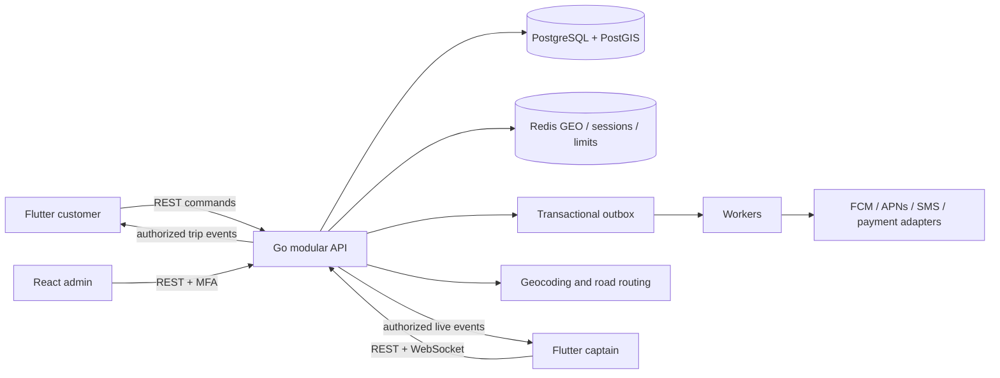

# Hop: India-wide, zero-commission bike-taxi platform

## Confirmed requirements

- India-wide product architecture; launch only in explicitly activated service areas.
- Go backend; target clients are separate Flutter customer and captain apps plus a React admin portal. The current React rider/driver web app remains the prototype and browser fallback.
- Riders pay drivers in cash or direct UPI. Platform commission is zero; no payment collection, wallet, escrow, or payment-success claims.
- Real service intent: persistent accounts, driver approval, booking integrity, operational controls, and traceable decisions.

## Product decisions

An India-wide launch is an operational rollout, not one global switch. Service areas carry state, boundaries, fare versions, and activation state. Operators must determine the applicable rules, vehicle/driver eligibility, insurance, safety/support coverage, and commercial terms per area. No city is auto-enabled in production.

Rider journey: sign in through a verified identity provider → choose active area and locations → receive a time-limited road-distance quote → request ride with an idempotency key → driver accepts → share pickup code at pickup → travel → complete → settle directly → history/support.

Driver journey: sign in → submit application and vehicle details → operator reviews evidence and expiry dates → approval → consent to foreground location → receive nearby requests while location is fresh → accept atomically → arrive → verify pickup code → complete. Opening a driver tab does not confer driver privileges.

Operator journey: separate application role → manage areas → review drivers → inspect trip/audit records → receive incident reports. Identity-provider administrators and application operators are distinct roles. First operator promotion uses an authenticated database maintenance command; public clients cannot promote themselves.

## Stack and tradeoffs

| Layer | Choice | Why |
|---|---|---|
| Customer and captain clients | Flutter, separate app targets over a shared typed API package | Native location lifecycle, push notifications and app-store delivery; keep customer and captain permissions/data isolated |
| Admin client | React, TypeScript, Vite | Separate operator workflows, role gates and deployment from customer apps |
| HTTP API | Go standard net/http | Concurrency, bounded requests, cancellation/timeouts, simple deployment |
| Customer/captain identity | Verified phone OTP through a managed identity/SMS provider; admin OIDC with MFA | Avoid building password or SMS-delivery security; separate consumer onboarding from privileged admin access |
| Mobile credentials | Short-lived access token plus rotating/revocable refresh session held in OS secure storage | Native clients cannot use the web-only HttpOnly cookie contract; never persist bearer tokens in ordinary preferences |
| Durable state | PostgreSQL + PostGIS | Transactions, uniqueness constraints, polygon service zones, spatial driver queries, audit and history |
| Ephemeral state | Redis | Sessions, rate limits, expiring driver GEO candidates and transient fanout; never the source of truth for rides |
| Routing | OSRM-compatible service adapter | Real road distance with bounded request time; self-hostable; no production dependency on a public demo router |
| Real-time | WebSocket gateway for authenticated trip/location streams; REST for commands and recovery snapshots | Low-latency tracking without making socket delivery authoritative |
| Async work | PostgreSQL transactional outbox plus workers; provider adapters for FCM/APNs/SMS | Durable push/retry, request expiry, scheduled rides, document reminders and payment reconciliation |
| Location | Native captain foreground/background location with explicit consent, accuracy/freshness checks and short retention | Mobile web cannot promise background tracking; customer location is requested only during booking |
| Delivery | Docker, TLS ingress, CI, secrets manager, metrics/logs/traces and backup/restore automation | Reproducible release and operational recovery |

A modular monolith remains the initial backend architecture. Separate microservices would add failure modes before traffic justifies them. Keep bounded Go modules for identity, profiles/KYC, fleet/catalog, geography, quotes/pricing, dispatch, rides, payments, safety/support, notifications and administration. PostgreSQL owns trip transitions; Redis is a rebuildable candidate/presence index, never the source of truth. Use WebSockets for live delivery, but persist every command/event before publishing and recover clients from REST snapshots after disconnect. No fleet-size or latency guarantees are claimed without representative load tests.

## Target request flow

Redis GEO is only a fast candidate lookup. Dispatch must re-check driver approval, category, service polygon, freshness, pickup radius, payment compatibility and current assignment inside a PostgreSQL transaction before acceptance. Store the selected route geometry and quote/pricing version with the quote so the same road path is rendered on the booking preview and active trip, including Satellite map mode. Driver positions are ephemeral; retain only the minimum trip/safety data required by a published retention policy.

Vehicle class and trip product must be explicit domain fields, not UI labels: bike, auto, mini, sedan, SUV, rental/hourly and outstation each need availability rules, route limits, fare rules, cancellation behavior and supported payment methods. Version fare rules per service zone and category; quote and booking must snapshot the applied rule. Zero platform commission is a separate invariant from payment processing fees, taxes, refunds and gateway settlement.

## Delivery sequence

1. **Operational pilot foundation:** one reviewed city/zone; phone OTP provider; customer/captain profiles; bike, auto and one cab class; real routing/geocoding; fare quote; PostGIS zones; driver onboarding and human KYC review; transactional dispatch; ride OTP; cash/direct UPI recording; basic admin portal, support and incident procedure.
2. **Reliable live service:** Flutter captain location lifecycle, WebSocket reconnect/snapshots, durable outbox, push notifications, tracking/ETA, document-expiry alerts, admin active-ride monitoring, observability, restore drills and load tests.
3. **Commercial expansion:** payment gateway and reconciliation/refunds, receipts/invoices, more vehicle classes, scheduled rides, multi-stop, rental/outstation and cancellation/no-show policies.
4. **Competitive features:** ratings, saved places, referrals, multilingual/voice booking, family sharing, favorite/repeat drivers, negotiation, destination mode, return matching, fairness/heatmaps and predictive features. Each feature needs abuse/privacy/cost criteria before it becomes a launch commitment.

The existing web implementation is not equivalent to these release gates: it currently uses OIDC email identity, browser foreground location, polling, a synthetic local router/geocoder, a single bike product, and manual direct-payment reporting. Keep it as a development prototype while building the target clients and provider integrations; do not present the local fixture as live dispatch or road navigation.

## State and consistency

`requested → accepted → arrived → in_progress → completed`; cancellation is allowed before trip start. A request expires if no driver accepts before its deadline. Partial unique indexes prevent multiple active trips per rider or driver. Transaction locks serialize acceptance and transitions. A request idempotency key returns the original trip on retries and rejects reuse for a different quote. Quotes are account-bound, immutable, short-lived and contain pricing version and route source. Server time governs expiry.

Driver availability requires approval, unexpired review documents, active service area, explicit online state, sufficiently accurate location, and a recent server-received heartbeat. Location timestamps supplied by the browser never extend freshness. Accept validates proximity and availability again; seeing a request is not a reservation.

Amounts use integer paise; commission is always zero in this release. Completion and direct-payment reporting are separate facts. The app cannot independently confirm a cash or external UPI payment.

## Security and privacy boundaries

Use verified OIDC issuer, client, redirect URI, PKCE, one-use login state, nonce, signed-token verification, and email verification. Native clients will need their own public client and token contract; web cookies are not a native mobile authentication design.

Production startup requires TLS public origin, secrets, PostgreSQL, Redis, identity and real routing configuration. Same-origin mutations require a session-bound CSRF token and matching Origin. Roles and ownership are checked server-side. Customer details are disclosed to assigned participants only. Raw sessions, codes, authorization headers and coordinates are not logged. Pickup codes use HMAC with a separate key and limited attempts.

Rate limits apply to authentication, quotes, bookings and transitions. They are defense-in-depth, not a substitute for edge protection, identity-provider controls or fraud operations. Operator MFA must be enforced at the identity provider. Do not store verification document files until private storage, retention and access policies are configured. Store review references accessible only to operators.

## Deliberately outside the first implementation

Native background tracking, verified phone/SMS provider, automatic KYC/document checks, integrated payment confirmation, nationwide road dataset hosting, call masking, push notifications, support staffing, automatic incident response, anti-fraud models, retention automation, disaster-recovery drills and external penetration testing. Incident reporting must never be advertised as an emergency dispatch service. An API or UI button alone does not establish operational readiness.

## Release gates

1. Functional and concurrency tests against actual PostgreSQL and Redis; browser checks on desktop and mobile sizes.
2. Identity-provider configuration, account verification/MFA and real routing validation in staging.
3. Operator review of activated states/areas, driver verification evidence, support process and privacy terms.
4. TLS, managed secrets, monitored backups and restore drill, migration rehearsal, rate limits, dependency/security scanning.
5. Real iOS Safari and Android Chrome location/permission testing, accessibility review, load tests with a declared traffic target.
6. Controlled pilot with approved drivers before widening areas.

This document is an engineering plan, not a statement of legal approval or a promise that nationwide operations are ready.
